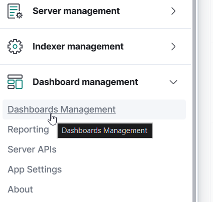
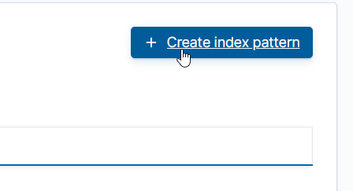
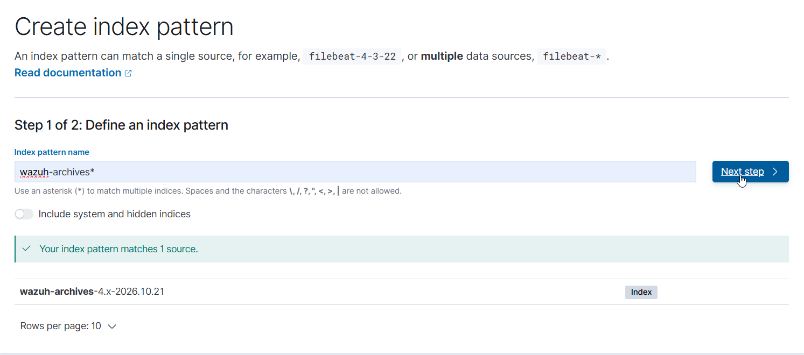
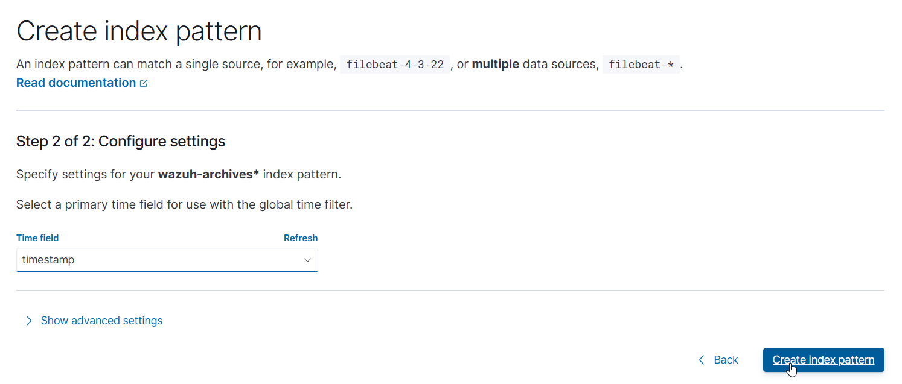

# Phase 1: Wazuh Server Deployment

## Environment
- Hypervisor: VirtualBox
- Guest OS: Ubuntu Server 24.04 LTS
- Host OS: Windows
- Networking: Bridged Adapter
- Adapter type: Paravirtualized Network (virtio-net)

## Installation Steps
1. Installed Ubuntu Server 24.04 LTS in VirtualBox
2. Enabled OpenSSH during install
3. Confirmed SSH access from host to the VM
4. Ran system updates:
```bash
   sudo apt update && sudo apt upgrade -y
```
5. Ran the Wazuh all-in-one install script:
```bash
   curl -sO https://packages.wazuh.com/4.x/wazuh-install.sh
   sudo bash wazuh-install.sh -a
```
6. Install script generated the admin username and password for the dashboard
7. Opened a browser on host, navigated to the Wazuh server's IP, logged in with the generated credentials

### Enabling Archives
By default, Wazuh only logs events that trigger an alert. Enabled full 
event archiving to support deeper investigation later (e.g. confirming 
an attack occurred even if no alert fired).

1. Edited `/var/ossec/etc/ossec.conf`, set both to `yes`:
```xml
   <logall>yes</logall>
   <logall_json>yes</logall_json>
```
```bash
   systemctl restart wazuh-manager.service
```
2. Edited `/etc/filebeat/filebeat.yml`, set:
```yaml
   archives:
     enabled: true
```
```bash
   systemctl restart filebeat.service
```
3. Created a new index pattern `wazuh-archives-*` in the Wazuh dashboard to view archived events

### Creating the Archives Index Pattern

After enabling archives in `ossec.conf` and `filebeat.yml`, created a new 
index pattern in the dashboard so archived events are viewable in Discover.

1. Navigated to **Dashboards Management → Index patterns**
   
   

2. Clicked **Create index pattern**
   
   

3. Entered `wazuh-archives*` — confirmed it matched the `wazuh-archives-4.x-2026.10.21` index
   
   

4. Selected `timestamp` as the time field and created the pattern
   
   

`wazuh-archives-*` pattern now available in Discover, alongside the 
default `wazuh-alerts-*` pattern, allowing review of all events — not just 
those that triggered alerts.

## Result
Wazuh server (manager, indexer, dashboard) successfully deployed on Ubuntu Server 24.04. Dashboard accessible via browser from host. Archives enabled to capture full event logs for later analysis, not just alerted events.
