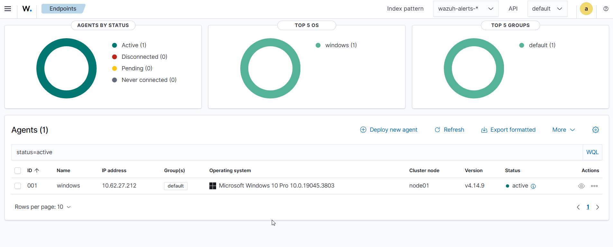
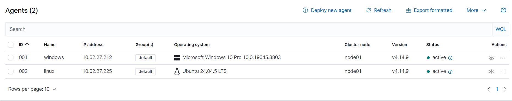

# Phase 2: Agent Deployment

## Environment
- New Ubuntu Server VM (Linux victim) — deployed in VirtualBox
- Windows 10 VM (Windows victim) — deployed in VirtualBox
- Both VMs: Bridged Adapter networking

## Installation Steps

### Windows Victim VM
1. In the Wazuh dashboard, navigated to **Agents → Deploy new agent**
2. Selected **Windows**, entered the Wazuh server IP, and copied the generated install command
3. Ran the generated command in an elevated PowerShell on the Windows VM — this downloaded and installed the Wazuh agent MSI and registered it with the manager automatically
4. Started the Wazuh agent service:
   ```powershell
   NET START WazuhSvc
   ```
5. Confirmed the agent appeared in the Wazuh dashboard's Agents page



6. Downloaded Sysmon from Microsoft Sysinternals:
   https://download.sysinternals.com/files/Sysmon.zip
7. Downloaded Olaf Hartong's sysmon-modular config (`sysmonconfig.xml`) from GitHub
8. Added `sysmonconfig.xml` to the Sysmon folder

9. Opened PowerShell in that folder and installed Sysmon with the config:
   ```powershell
   .\Sysmon64.exe -accepteula -i sysmonconfig.xml
   ```

10. Verified install:
    ```powershell
    Get-Service Sysmon64
    ```

11. Opened Notepad as Administrator, navigated to:
C:\Program Files (x86)\ossec-agent\ossec.conf
    and modified the file to point to the Sysmon event channel:
    ```xml
    <localfile>
      <location>Microsoft-Windows-Sysmon/Operational</location>
      <log_format>eventchannel</log_format>
    </localfile>
    ```

12. Restarted the Wazuh agent service to apply the config, then checked the Wazuh dashboard's **Discover** page (filtered by this agent) to confirm Sysmon events were flowing in


    

### Linux Victim VM
1. In the Wazuh dashboard, navigated to **Agents → Deploy new agent**
2. Selected **Linux (deb)**, entered the Wazuh server IP, and copied the generated install command
3. Ran the generated command on the Ubuntu VM — this downloaded the `.deb` package, installed it, and registered the agent with the manager
4. Enabled and started the agent service:
   ```bash
   sudo systemctl enable wazuh-agent
   sudo systemctl start wazuh-agent
   ```
5. Confirmed the agent appeared in the Wazuh dashboard's Agents page



6. Installed Sysmon for Linux (official Microsoft package):
   ```bash
   wget -q https://packages.microsoft.com/config/ubuntu/$(lsb_release -rs)/packages-microsoft-prod.deb -O packages-microsoft-prod.deb
   sudo dpkg -i packages-microsoft-prod.deb
   sudo apt-get update
   sudo apt-get install sysmonforlinux
   ```
7. Downloaded Microsoft's MSTIC-Sysmon Linux config (`collect-all.xml`), sourced via MyDFIR's YouTube tutorial:
   ```bash
   wget https://raw.githubusercontent.com/microsoft/MSTIC-Sysmon/refs/heads/main/linux/configs/collect-all.xml
   ```
8. Applied the config:
   ```bash
   sudo sysmon -i collect-all.xml
   ```
9. Confirmed agent shows as **Active** in the Wazuh dashboard
10. Checked the Wazuh dashboard's **Discover** page (filtered by this agent) to confirm Sysmon for Linux events were flowing in


## Result
Both Linux and Windows victim VMs deployed with Wazuh agents installed 
via the dashboard's deployment wizard, and reporting as Active. Sysmon 
installed on both — Sysmon for Linux with Microsoft's MSTIC collect-all 
config on Ubuntu, and Sysmon on Windows with Olaf Hartong's 
sysmon-modular config — providing detailed process, network, and system 
event logging beyond default OS logs, ready for attack simulation in 
Phase 3.
